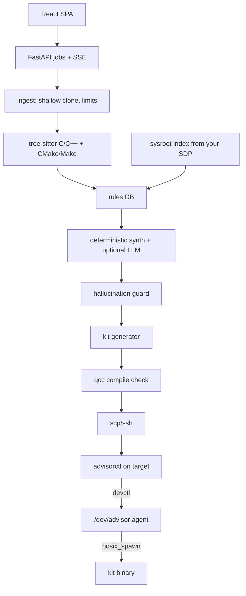

# QNX Integration Advisor

A local-first developer tool for bringing Linux/POSIX C and C++ code to **QNX SDP 8.0**.
Give it a GitHub/GitLab/Bitbucket URL or a local checkout and it produces:

1. **A sysroot-verified compatibility audit.** Every system header and libc/SDK symbol the repo
   uses is checked against *your* QNX SDP 8.0 installation (indexed locally with the SDP's own
   `nto*-nm`), so "is `epoll_wait` available? which library has `inotify_add_watch`?" is answered
   from your sysroot, not from memory.
2. **A three-pillar integration report:** relevant QNX features and why (resource managers,
   channels/pulses, priority inheritance, `SCHED_SPORADIC`, run-masks, `procmgr` daemon-death
   notifications (HAM where the optional HA package is installed), `procmgr_ability()`,
   slog2, tracelogger), concrete improvements tied to source lines, and ordered step-by-step
   guidance with before/after code and a verification command per step.
3. **A QNX 8.0 porting kit:** CMake toolchain file, only the compatibility shims the repo needs,
   a `/dev/<service>` resource-manager skeleton, a devctl client, a `mkqnximage` launch script
   and a per-repo codelab. Kit C files are compiled with `qcc` (x86_64 and aarch64le) when an
   SDP is present.
4. **Live target verification:** the kit is cross-compiled, copied over SSH to a QNX 8.0 QEMU VM
   (or Raspberry Pi 5), started under the native `/dev/advisor` resource manager, and
   **measured** (resource-manager start-up time, `MsgSend` round trips, pulse-timer wake-up
   lateness idle and under load).

The tool advises and scaffolds. It does not promise a fully automatic port.

## Quick start (no setup knowledge needed)

You need **Python 3.11 or newer** ([python.org](https://www.python.org/downloads/); on Windows tick
"Add python.exe to PATH") and an internet connection the first time. Node.js is **not** needed:
the web UI ships pre-built.

1. Download the project: **Code → Download ZIP** on GitHub and unzip it, or `git clone` it.
2. Start it:
   - **Windows:** double-click **`start.bat`**.
   - **Linux / WSL2 / macOS:** run `./start.sh` in the project folder.
3. Your browser opens at **http://127.0.0.1:8765**. Click **⚙ Setup** to check everything is
   connected and, optionally, add an AI key. Then paste a GitHub/GitLab/Bitbucket URL or a local
   folder path and click **Analyze**, or click one of the sample reports.

The first start takes a minute or two while it installs into a private `.venv` folder. Later starts
take a few seconds. Keep the launcher window open while you use the tool; close it (or press Ctrl+C)
to stop. With QNX SDP 8.0 installed, run `source ~/qnx800/qnxsdp-env.sh` before `./start.sh` and
results are checked against your sysroot.

### Developer setup

```bash
git clone <this repo> && cd qnx-integration-advisor
make setup                     # Python venv + deps + web UI (needs Python 3.11+, Node 20)
.venv/bin/qnx-advisor serve    # http://127.0.0.1:8765
```

Without make (any OS, including Windows):

```bash
python -m venv .venv && .venv/bin/pip install -e ".[dev]"      # Windows: .venv\Scripts\pip
cd web && npm ci && npm run build && cd ..
.venv/bin/qnx-advisor scan samples/motor-pid-controller --format md --out motor.md --kit motor-kit
```

### Modes

| Mode | Needs | What you get |
| :--- | :--- | :--- |
| **M0 Viewer** | a browser | Pre-generated reports for the samples (`make static`; published to GitHub Pages) |
| **M1 Deterministic** | Python, git | Full audit, 3-pillar report and kit from rules + templates. Without an SDP, results are labelled *unverified against sysroot* |
| **M2 AI-assisted** | M1 + an LLM key | Repo-specific prose and diagrams, all filtered by the hallucination guard |
| **M3 Live target** | M1/M2 + QNX SDP 8.0 + a QNX 8.0 target over SSH | `qcc` builds, deployment, `/dev/advisor` verification and measured benchmarks |

The UI header shows the active mode and why (for example "no QNX SDP found; no target configured").

### With QNX SDP 8.0 (M1 verified, M3)

```bash
source ~/qnx800/qnxsdp-env.sh
make index-sdp          # writes ~/.qnx-advisor/sysroot-index-<ver>.json (names only, never committed)
make rules-validate     # every API the rules recommend must exist in your sysroot
make qnx-check          # renders kits for all samples, compiles with qcc for both archs -> docs/qnx-check-log.txt
make vm                 # mkqnximage QEMU target + builds/installs the agent (qnx-target/vm/setup-vm.sh)
make demo               # scan -> kit -> verify on the VM -> docs/sample-verification-record.json
```

### AI-assisted mode (optional)

**Easiest:** click **⚙ Setup** in the top-right corner of the web UI. Pick a provider (OpenRouter is
the simplest: one key for many models), paste your API key and press **Save and test connection**.
The Setup page also shows a plain-language checklist (Git, code parser, AI, QNX SDP) with a
"how to fix" line for anything missing. Keys saved there stay on your computer
(`~/.qnx-advisor/settings.json`), are shown only masked, and also apply to the CLI.

Power users can set an environment variable instead. When several keys are set, the first in this
table wins; override with `QNX_ADVISOR_LLM=openrouter|claude|gemini|openai`. A key saved on the
Setup page takes priority over environment variables.

| Key | Provider | Default model | Change model with |
| :--- | :--- | :--- | :--- |
| `OPENROUTER_API_KEY` | [OpenRouter](https://openrouter.ai) (one key, many models) | `anthropic/claude-opus-5.5` | `QNX_ADVISOR_OPENROUTER_MODEL` (any OpenRouter model id, e.g. `google/gemini-2.5-pro`) |
| `ANTHROPIC_API_KEY` | Anthropic, official `anthropic` SDK | `claude-opus-5-5` | `QNX_ADVISOR_MODEL` |
| `GEMINI_API_KEY` | Google Gemini | `gemini-2.5-pro` | `QNX_ADVISOR_GEMINI_MODEL` |
| `OPENAI_API_KEY` | OpenAI | `gpt-4.1` | `QNX_ADVISOR_OPENAI_MODEL` |

The launchers (`start.bat` / `start.sh`) install the client libraries for all of them.
Deterministic mode stays complete; the LLM only rewrites prose, adds diagrams and suggests extra
improvements. If the provider fails or declines, the deterministic report is used unchanged.

**Hallucination guard.** Every API-looking identifier and `<header.h>` in LLM output must exist in
your sysroot index, the rule DB, or the repo's own symbols, or the sentence/code block is removed
and counted (shown in the UI as "N unverified claims removed"). Numeric performance claims are
stripped unless they come from a target measurement. Repo text is passed as quoted data and LLM
output never reaches a shell.

## Tested configuration

| Item | Value |
| :--- | :--- |
| Host | Ubuntu 24.04 (native or WSL2); Windows 11 for M1 |
| QNX SDP | 8.0.x (exact patch printed by `make env-info`) |
| Target | `x86_64` QEMU via `mkqnximage`; optional Raspberry Pi 5 (`aarch64le`) |
| Compiler | `qcc` from the SDP; version printed at runtime by `make env-info` (never hardcoded) |
| Python / Node | 3.11+ / 20 |

> [!NOTE]
> Checked on Ubuntu (WSL2) with QNX SDP 8.0.0 and `qcc` 12.2.0:
> - `make agent`: the native agent and `advisorctl` build for x86_64 and aarch64le with
>   `-Wall -Wextra -Werror`.
> - `make qnx-check`: 18/18 kit compilations succeed with 0 warnings
>   ([`docs/qnx-check-log.txt`](docs/qnx-check-log.txt)).
> - `make rules-validate`: every API the rules recommend exists in the SDP 8.0.0 sysroot index.
>
> The M1 pipeline, web UI, tests and evaluation also run on Windows 11 without an SDP.
> - `make demo` on a QNX 8.0.0 QEMU target (x86_64): the agent spawned the generated
>   `motor_pid` resource manager, `/dev/motor_pid` appeared after 5.3 ms, and the agent then
>   stopped it as designed ([`docs/sample-verification-record.json`](docs/sample-verification-record.json)).
>   In that record `exit_status: -1` means the service ended by signal, not that it failed.
>   QEMU timings are indicative only.

## Evidence of QNX use

| Evidence | Location |
| :--- | :--- |
| Native QNX resource manager `/dev/advisor` (`dispatch_create`, `resmgr_attach`, `iofunc_*`, `pulse_attach`, `message_connect`) | [`qnx-target/src/agent/qnx_advisor_agent.c`](qnx-target/src/agent/qnx_advisor_agent.c) |
| devctl protocol (`__DIOTF`), `posix_spawn` with SCHED attributes, async `MsgReplyv`, timer pulses, `waitid` waiter thread | [`qnx-target/src/agent/verify.c`](qnx-target/src/agent/verify.c), [`advisor_dcmd.h`](qnx-target/src/agent/advisor_dcmd.h) |
| `ClockCycles()` benchmarks: `MsgSend` round trips, SCHED_FIFO pulse-timer lateness under load | [`qnx-target/src/agent/bench.c`](qnx-target/src/agent/bench.c) |
| Least privilege via `procmgr_ability` (+ optional secpol policy), slog2 logging | `qnx_advisor_agent.c`, [`qnx-target/secpol/`](qnx-target/secpol/) |
| `qcc` builds for x86_64 and aarch64le | [`qnx-target/Makefile`](qnx-target/Makefile), [`advisor/sdp/toolchain.py`](advisor/sdp/toolchain.py), `docs/qnx-check-log.txt` |
| Sysroot indexing with the SDP's `nto*-nm` (pure-Python ELF reader as fallback) | [`advisor/sdp/indexer.py`](advisor/sdp/indexer.py), [`advisor/sdp/elf.py`](advisor/sdp/elf.py) |
| Generated QNX resource manager, shims and toolchain file | [`advisor/kit/templates/`](advisor/kit/templates/) |
| QEMU target via `mkqnximage` | [`qnx-target/vm/`](qnx-target/vm/) |
| Measured output from a QNX 8.0 target | `docs/sample-verification-record.json` (produced by `make demo`) |

## How it works



- `advisor/ingest`: URL validation, `git clone --depth 1` with argument arrays, 90 s / 300 MB limits,
  vendored dirs skipped.
- `advisor/scanner`: tree-sitter extraction of includes, calls, string literals, `#ifdef __QNX__`/
  `__linux__` context and loop context; CMake/Make link libraries and flags; role heuristics
  (device service, periodic control loop, daemon, IPC server). A regex scanner is the fallback.
- `advisor/rules`: 23 rules corrected for SDP 8.0 (no APS; inotify via `-lfsnotify`; pthread/rt/dl
  flagged only when the library is missing from your sysroot; `posix_spawn` over `fork`; HAL
  advice for SocketCAN/I2C/SPI, no false 1:1 claims). Severity comes from the sysroot lookup.
- `advisor/synth`: deterministic three-pillar report; optional provider-agnostic LLM layer + guard.
- `advisor/kit`: Jinja2 templates; `advisor/verify`: qcc, SSH deploy, measurements, verification record.
- `qnx-target/`: the native agent and `advisorctl`, built with `qcc`.

The readiness score is deterministic: `max(0, 100 − Σ weight × min(hits, 3))` with blocker 15,
high 6, medium 2, low 1; findings already inside QNX/Linux guards weigh 0.

## Safety and licensing

- **Local-first.** No QNX headers, libraries, `qcc`, images or VM disks are committed or served.
  The sysroot index is generated on your machine and gitignored. No public endpoint runs `qcc`
  or a QNX VM; the optional public page is a static viewer of our own sample reports.
- **Your repo is never built or executed on the host.** It is cloned and read. Only the generated
  kit is compiled.
- The server binds to `127.0.0.1` by default.
- Read the QNX Everywhere license you accepted on myQNX; it is non-commercial and restricts
  redistribution and hosted use of QNX software.

## Testing and evaluation

```bash
make test     # 37 unit/API tests (no SDP needed)
make eval     # precision/recall vs hand-labelled expectations in eval/golden.yaml
make lint
```

Current result on the three samples: precision 1.00, recall 1.00 (38 expected findings). The samples
were written alongside the rules, so treat this as a regression check. `eval/corpus.yaml` lists
public repositories to pin and label for an independent estimate.

## Codelab

[`codelabs/docs/index.md`](codelabs/docs/index.md): *Bring Your Linux C Project to QNX 8.0:
Resource Managers, Pulses and Real-Time Timers* (MkDocs Material; published by
`.github/workflows/pages.yml`). Every step works with or without the tool.

## Known limitations

- C/C++ only at full depth; other languages get build-level hints at most.
- CAN/I2C/SPI guidance is a HAL plus a QNX stub: the `DCMD_*` set depends on your board's driver.
- QEMU timings include virtualization overhead and are labelled "QEMU, indicative only".
- `tracelogger` capture (`/api/jobs/{id}/trace.kev`) is not implemented yet.
- The web UI uses a built-in side-by-side diff rather than Monaco, and plain CSS rather than
  Tailwind, to keep the local build small and fully offline.
- The secpol policy in `qnx-target/secpol/` is illustrative; check its syntax against your SDP.

## License

Apache-2.0 (see [LICENSE](LICENSE)). The sample projects in `samples/` are original works under MIT
([samples/LICENSE-MIT](samples/LICENSE-MIT)). "QNX" refers to the platform only.
