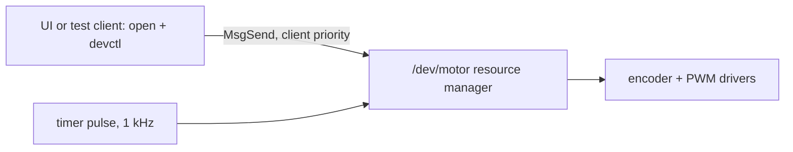

# Bring Your Linux C Project to QNX 8.0: Resource Managers, Pulses and Real-Time Timers

**Duration:** 45 to 60 minutes · **Level:** you know C and Linux; you are new to QNX

You will take a small Linux motor controller (a 1 kHz PID loop built on `timerfd`, `epoll` and
a default mutex) and turn it into an idiomatic QNX 8.0 program:

1. Set up QNX SDP 8.0 and a QEMU target
2. Audit the project against your own SDP sysroot
3. Replace `timerfd` with a pulse-delivering POSIX timer
4. Turn device access into a `/dev/motor` resource manager with `devctl()`
5. Add priority inheritance and measure timer lateness with and without load
6. Drop privileges with `procmgr_ability()`
7. Optional: capture a kernel trace and look at it in the System Profiler

Every step stands on its own. You can follow it with or without QNX Integration Advisor; where
the tool saves time, the step says so and also shows how to do it by hand.

!!! note "What you need"
    - A Linux host or Windows with WSL2 (Ubuntu 22.04 or 24.04), with QEMU installed
    - A free QNX account and QNX SDP 8.0 from QNX Everywhere, installed with the QNX Software Center
    - An SSH key (`ssh-keygen -t ed25519`)
    - The sample project: `samples/motor-pid-controller` from this repository

---

## Step 1: Set up the SDP and a QEMU target

Install QNX SDP 8.0 by following the official QNX Everywhere quick start, then load the
environment in every shell you use for QNX work:

```sh
source ~/qnx800/qnxsdp-env.sh
qcc -V            # lists the compiler variants, e.g. gcc_ntox86_64 and gcc_ntoaarch64le
```

`mkqnximage` builds a ready-to-boot QEMU image. Make a working directory and build one that
accepts your SSH key:

```sh
mkdir -p ~/qnx-vm && cd ~/qnx-vm
mkqnximage --type=qemu --arch=x86_64 --ssh-ident=$HOME/.ssh/id_ed25519.pub
mkqnximage --run=-h &          # boot headless
mkqnximage --getip             # prints the VM's address, e.g. 172.31.1.11
ssh qnxuser@$(mkqnximage --getip) uname -a
```

You should see `QNX localhost 8.0.0 ...`. Options can differ between SDP patch levels; run
`mkqnximage --help` if one is rejected.

!!! tip "On WSL2"
    Enable nested virtualization so QEMU can use KVM, and run QEMU and your tools inside the
    same WSL2 distribution so the VM's network address is reachable.

## Step 2: Audit the project against your sysroot

The question for any port is "which of the APIs I use exist on the target?" The reliable
answer comes from the SDP you installed, not from memory.

=== "With QNX Integration Advisor"

    ```sh
    make setup                 # venv, Python deps, web UI
    qnx-advisor index-sdp      # names of headers, macros and exported symbols, kept in ~/.qnx-advisor
    qnx-advisor scan samples/motor-pid-controller --format md --out motor.md --kit motor-kit
    ```

    The report flags `epoll_*` and `timerfd_*` as **missing in your sysroot**, shows `inotify`
    as **available with `-lfsnotify`**, and points at the default mutex shared between a
    priority-80 control thread and a low-priority telemetry thread.

=== "By hand"

    List the headers and calls the code uses, then look them up in the SDP:

    ```sh
    grep -rhoE '#include <[^>]+>' samples/motor-pid-controller/src | sort -u
    ls $QNX_TARGET/usr/include/sys/ | grep -E 'epoll|timerfd|inotify'
    ntox86_64-nm -D --defined-only $QNX_TARGET/x86_64/lib/libc.so* | grep -E ' (epoll_wait|timerfd_create)$'
    for f in $QNX_TARGET/x86_64/usr/lib/*.so*; do
      ntox86_64-nm -D --defined-only "$f" 2>/dev/null | grep -q ' inotify_add_watch$' && echo "$f"
    done
    ```

    Whatever is not found needs a replacement; a symbol found in a library other than
    `libc` needs that library on the link line.

**Check:** you have a list of missing APIs (expect `epoll` and `timerfd`) and know that
`inotify` needs `-lfsnotify`.

## Step 3: Replace `timerfd` with a pulse-delivering timer

On QNX a timer can deliver a **pulse**: a small, non-blocking message with a code, a value and
a priority, sent to a **channel**. A thread blocked in `MsgReceivePulse()` wakes up at the
pulse's priority. This gives you the timerfd behaviour plus a priority, and it is the building
block for everything in the next steps.

```c
#include <stdint.h>
#include <time.h>
#include <sys/neutrino.h>
#include <sys/siginfo.h>

#define PULSE_TIMER (_PULSE_CODE_MINAVAIL + 0)

typedef struct { int chid, coid; timer_t timer; } periodic_t;

static int periodic_create(periodic_t *t, uint64_t period_ns, int prio)
{
    struct sigevent ev;
    struct itimerspec its;

    t->chid = ChannelCreate(0);
    if (t->chid == -1) return -1;
    t->coid = ConnectAttach(0, 0, t->chid, _NTO_SIDE_CHANNEL, 0);
    if (t->coid == -1) return -1;

    SIGEV_PULSE_INIT(&ev, t->coid, prio, PULSE_TIMER, 0);
    if (timer_create(CLOCK_MONOTONIC, &ev, &t->timer) == -1) return -1;

    its.it_value.tv_sec = period_ns / 1000000000ULL;
    its.it_value.tv_nsec = period_ns % 1000000000ULL;
    its.it_interval = its.it_value;
    return timer_settime(t->timer, 0, &its, NULL);
}

static int periodic_wait(periodic_t *t)
{
    struct _pulse p;
    do {
        if (MsgReceivePulse(t->chid, &p, sizeof p, NULL) == -1) return -1;
    } while (p.code != PULSE_TIMER);
    return 0;
}
```

In `main.c`, replace the `timerfd_create`/`timerfd_settime`/`epoll_wait` block with:

```c
periodic_t t;
if (periodic_create(&t, 1000000 /* 1 ms */, 30) != 0) { perror("periodic_create"); return 1; }
for (;;) {
    if (periodic_wait(&t) != 0) break;
    double rpm = motor_io_read_rpm();
    /* ... unchanged PID step and PWM write ... */
}
```

The config-file watcher can stay on `inotify` (link with `-lfsnotify`, and make sure `fsevmgr`
runs on the target) or be polled with `poll()` from a second thread.

!!! tip "Shortcut"
    The porting kit's `include/qnx_compat.h` contains exactly this shim (and keeps the Linux
    `timerfd` path under `#ifndef __QNX__`), with `tests/compat_selftest.c` to try it.

**Check:** build and run it on the target.

```sh
qcc -Vgcc_ntox86_64 -Wall -Wextra -o compat_selftest motor-kit/tests/compat_selftest.c -Imotor-kit/include
scp compat_selftest qnxuser@$(mkqnximage --getip):
ssh qnxuser@$(mkqnximage --getip) ./compat_selftest      # "periodic timer: 100 periods ok"
```

## Step 4: Make the device a `/dev/motor` resource manager

Linux code usually opens a device and drives it from inside the application. On QNX, drivers and
services are **resource managers**: ordinary processes that register a path name such as
`/dev/motor`. Clients use `open()`, `read()`, `write()` and `devctl()`, and each call arrives at
the resource manager as a message. Two things you get for free:

- the request runs at the **client's priority** (message passing inherits priority), and
- the service is a separate process that can be restarted without touching its clients.



The skeleton has four parts: a dispatch structure, default POSIX handlers from `iofunc`,
your own handlers for the calls you care about, and the path registration.

```c
#include <devctl.h>
#include <sys/dispatch.h>
#include <sys/iofunc.h>

typedef struct { int32_t setpoint_rpm; uint64_t ticks; } motor_status_t;
#define DCMD_MOTOR_GET_STATUS  __DIOF(_DCMD_MISC, 0x01, motor_status_t)
#define DCMD_MOTOR_SET_RPM     __DIOT(_DCMD_MISC, 0x02, int32_t)

static motor_status_t status;
static resmgr_connect_funcs_t cfuncs;
static resmgr_io_funcs_t      iofuncs;
static iofunc_attr_t          attr;

static int io_devctl(resmgr_context_t *ctp, io_devctl_t *msg, RESMGR_OCB_T *ocb)
{
    int rc = iofunc_devctl_default(ctp, msg, ocb);
    if (rc != _RESMGR_DEFAULT) return rc;

    void  *data = _DEVCTL_DATA(msg->i);
    size_t nbytes = 0;
    switch (msg->i.dcmd) {
    case DCMD_MOTOR_GET_STATUS:
        if (msg->i.nbytes < sizeof status) return EINVAL;
        memcpy(data, &status, sizeof status);
        nbytes = sizeof status;
        break;
    case DCMD_MOTOR_SET_RPM: {
        int32_t v;
        if (msg->i.nbytes < sizeof v) return EINVAL;
        if (resmgr_msgread(ctp, &v, sizeof v, sizeof msg->i) != (ssize_t)sizeof v) return EFAULT;
        status.setpoint_rpm = v;
        break;
    }
    default:
        return ENOSYS;
    }
    memset(&msg->o, 0, sizeof msg->o);
    msg->o.nbytes = nbytes;
    return _RESMGR_PTR(ctp, &msg->o, sizeof msg->o + nbytes);
}

static int on_tick(message_context_t *ctp, int code, unsigned flags, void *h)
{
    (void)ctp; (void)code; (void)flags; (void)h;
    status.ticks++;
    /* read encoder, PID step, write PWM: the old loop body */
    return 0;
}
```

In `main()`: `dispatch_create()`, `iofunc_func_init()`, set `iofuncs.devctl = io_devctl`,
`iofunc_attr_init()`, `resmgr_attach(dpp, &rattr, "/dev/motor", ...)`, then
`pulse_attach()` for the tick handler and a timer whose pulse goes to
`message_connect(dpp, MSG_FLAG_SIDE_CHANNEL)`. Finish with the
`dispatch_block()`/`dispatch_handler()` loop. Because the tick handler and client requests run
in the same thread, the PID state needs no mutex at all.

!!! tip "Shortcut"
    `motor-kit/src/qnx_motor_pid_resmgr.c` is a complete, compile-checked version of this
    skeleton with `read()`, `write()`, `devctl()` and the timer already wired, plus a client in
    `motor-kit/src/motor_pidctl.c`. Build both with `make -f Makefile.qnx`.

**Check:**

```sh
ssh root@$VM '/data/home/qnxuser/motor_pid_resmgr &'
ssh qnxuser@$VM 'ls -l /dev/motor_pid && ./motor_pidctl set 1500'
```

## Step 5: Priority inheritance, measured

The Linux version shares `gains_lock` between the control thread (priority 80) and a telemetry
thread that holds the lock while it sleeps. If a medium-priority thread preempts the telemetry
thread while it holds the lock, the control thread waits for both: priority inversion.

Fix it where the mutex is created:

```c
pthread_mutexattr_t ma;
pthread_mutexattr_init(&ma);
pthread_mutexattr_setprotocol(&ma, PTHREAD_PRIO_INHERIT);
pthread_mutex_init(&gains_lock, &ma);
pthread_mutexattr_destroy(&ma);
```

(After Step 4 the lock may be gone entirely, since QNX message passing already inherits priority.)

Now measure, rather than assume. The advisor's target agent runs a SCHED_FIFO thread on a
1 kHz pulse timer and records how late each wake-up is, first idle, then with four low-priority
threads burning CPU:

```sh
make agent && qnx-target/vm/install-agent.sh $VM
ssh qnxuser@$VM '/data/home/qnxuser/bin/advisorctl bench-timer --period-us 1000 --duration-ms 5000 --priority 40 --load 0'
ssh qnxuser@$VM '/data/home/qnxuser/bin/advisorctl bench-timer --period-us 1000 --duration-ms 5000 --priority 40 --load 4'
```

Compare `p99_us` and `max_us` between the two runs. Write down your own numbers.

!!! warning "QEMU numbers are indicative only"
    A virtual machine adds scheduling noise from the host. Use real hardware (for example a
    Raspberry Pi 5 with `ARCH=aarch64le`) for numbers you intend to quote.

## Step 6: Drop privileges with `procmgr_ability()`

The Linux daemon runs as root for its whole life. On QNX, root's power is split into
**abilities**. Do the privileged work first (registering `/dev/motor` needs the path-space
ability), then keep only what you still need, lock everything else, and switch user:

```c
#include <sys/procmgr.h>

/* after resmgr_attach() */
int rc = procmgr_ability(0,
    PROCMGR_ADN_NONROOT | PROCMGR_AOP_DENY | PROCMGR_AOP_LOCK | PROCMGR_AID_EOL);
if (rc != EOK) { fprintf(stderr, "procmgr_ability: %s\n", strerror(rc)); return 1; }
if (setgid(1000) == -1 || setuid(1000) == -1) { perror("setuid"); return 1; }
```

If the service must keep an ability (for example to raise thread priorities), allow that one
explicitly for the non-root domain before the final deny-and-lock entry.

**Check:** `pidin -p motor_pid_resmgr arg` shows the process running as uid 1000, and
`/dev/motor` still answers `motor_pidctl`.

## Step 7 (optional): See it in the System Profiler

Capture a few seconds of kernel events while the resource manager runs:

```sh
ssh root@$VM 'tracelogger -s 2 -f /tmp/motor.kev'     # see `use tracelogger` for all options
scp root@$VM:/tmp/motor.kev .
```

Open `motor.kev` in the System Profiler (Momentics IDE or the QNX Toolkit for VS Code). Look for
the timer pulses arriving every millisecond, the resource manager's thread running at the
pulse priority, and client `MsgSend` calls inheriting their caller's priority.

---

## What you learned

- How to check API availability against your own SDP instead of guessing
- Pulses and channels as the QNX way to wake a thread with a priority
- Resource managers: path names, `devctl()` and priority-inheriting message passing
- Priority inheritance and how to measure timing instead of asserting it
- Least privilege with `procmgr_ability()`

Next: run `qnx-advisor scan` on your own repository, and use the generated `PORTING_GUIDE.md`
as your personal version of this codelab.
