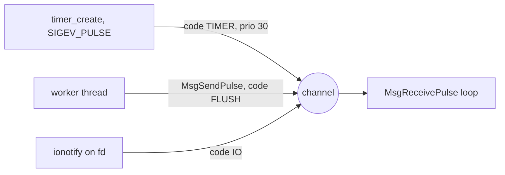
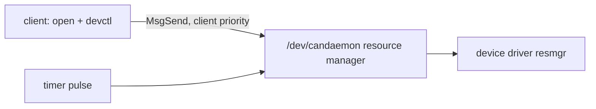

# QNX 8.0 Integration Report: samples/can-telemetry-daemon

Commit `local` · mode M1 · SDP 8.0.0 · generated 2026-11-11T23:31:24Z

**Readiness score: 0/100** (score = max(0, 100 - sum(weight(severity) x min(hits, 3))); blocker 15, high 6, medium 2, low 1; guarded findings weigh 0)

14 finding(s) across 3 file(s): 2 blocker, 3 high, 7 medium, 1 low, 1 info. 5 rule(s) depend on APIs missing from your QNX SDP 8.0.0 sysroot. Detected roles: device service, daemon, ipc server. Recommended shape on QNX: a /dev/candaemon resource manager driven by a pulse timer. Readiness score 0/100 (deterministic formula).

## Compatibility audit

| Severity | Rule | Sysroot | Locations | Guidance |
| :--- | :--- | :--- | :--- | :--- |
| blocker | LNX-EPOLL epoll event loop | missing | `src/candaemon.c:15`, `src/candaemon.c:113`, `src/candaemon.c:117`, `src/candaemon.c:125` | epoll is a Linux-only readiness API. On QNX use POSIX poll()/select() for the lowest-effort port, or restructure the loop around a channel so I/O readiness (ionotify), timers and IPC all arrive as prioritized pulses on one receive call. |
| blocker | LNX-SOCKETCAN SocketCAN | missing | `src/candaemon.c:24`, `src/candaemon.c:25`, `src/candaemon.c:36`, `src/candaemon.c:44` | QNX CAN drivers are resource managers (for example /dev/can1/rx0) controlled through devctl(); the command set depends on the driver for your board. There is no 1:1 SocketCAN replacement. Put CAN access behind a HAL interface and add a QNX backend. Check that a CAN driver exists for your target board first. |
| high | LNX-EVENTFD eventfd notifier | missing | `src/candaemon.c:16`, `src/candaemon.c:102` | eventfd is used here as a thread-to-loop wake-up. On QNX a pulse sent to the loop's channel does the same job without a file descriptor, and carries a code and a value. A pipe is the portable fallback. |
| high | LNX-PRCTL-CAPS Root-only daemon / Linux capabilities | available | `candaemon.service:9` | QNX splits root's power into abilities. Start as root only long enough to do the privileged setup (for example registering a path name), then call procmgr_ability() to keep just the abilities you need, lock the rest, and switch to an unprivileged user. A secpol policy can express the same thing declaratively. |
| high | LNX-SIGNALFD signalfd | missing | `src/candaemon.c:18`, `src/candaemon.c:111` | Block the signals in all threads and handle them in a dedicated thread with sigwaitinfo(), which then notifies the main loop (for example with a pulse). |
| medium | BLD-COMPILER Host-only compiler settings | available | `Makefile:1` | Cross-compile with qcc/q++ and a -V variant (gcc_ntox86_64, gcc_ntoaarch64le). Remove host-only flags such as -march=native and hardcoded gcc, and do not fail the build when CMAKE_SYSTEM_NAME is not Linux. The kit's toolchain file sets all of this. |
| medium | LNX-FORK fork() in a multithreaded program | available | `src/candaemon.c:84` | posix_spawn() is the recommended way to start processes on QNX. fork() in a multithreaded program is unsafe under POSIX on any OS, because only the calling thread is copied and locks held by other threads stay locked in the child. |
| medium | LNX-IOCTL ioctl on device descriptors | available | `src/candaemon.c:42` | QNX offers ioctl() as a wrapper over devctl() for common requests, but driver-specific requests must be rewritten against the QNX driver's DCMD_* set. Wrap device access in a small hardware-abstraction layer (HAL) so the Linux and QNX implementations can live side by side. |
| medium | LNX-LIBS Linux-only link libraries | missing | `Makefile:3` | On QNX the pthread, real-time and dynamic-loading functions are part of libc. Drop a -l flag only if that library is missing from the sysroot (the audit checks this). In CMake prefer find_package(Threads) + Threads::Threads. |
| medium | LNX-PROCFS Linux /proc paths | available | `src/candaemon.c:76` | QNX's /proc is different: per-process information is read with devctl(DCMD_PROC_*) on /proc/<pid>/as. Free memory can be read from the size of /proc itself. |
| medium | LNX-SOCKLIB BSD sockets without libsocket | available | `src/candaemon.c:36`, `src/candaemon.c:45`, `src/candaemon.c:51`, `src/candaemon.c:55` | On QNX the socket API lives in libsocket, not libc. Add -lsocket to the link line and make sure the io-sock network manager runs on the target. (link: -lsocket) |
| medium | LNX-SYSTEMD systemd unit / watchdog script | available | `candaemon.service:1` | QNX targets have no systemd. Start the service from the image's startup script (or SLM where available), daemonize with procmgr_daemon(), and supervise daemon processes using procmgr_event_notify_add(PROCMGR_EVENT_DAEMON_DEATH, ...) (or HAM where the optional High Availability package is installed). |
| low | LNX-PERIODIC-SLEEP sleep-based periodic loop | available | `src/candaemon.c:67` | A relative sleep inside a loop drifts by the loop body's run time. Use clock_nanosleep(CLOCK_MONOTONIC, TIMER_ABSTIME, ...) with a running deadline, or a pulse timer when the thread also needs to receive other events. |
| info | LNX-LOG syslog logging | available | `src/candaemon.c:37`, `src/candaemon.c:42`, `src/candaemon.c:45`, `src/candaemon.c:56` | syslog() works on QNX. slog2 (slog2_register, slog2f) is recommended for structured, low-overhead logs that you can read with slog2info. |

## Why QNX?

**Strong fit: candaemon does the kind of real-time, device or service work QNX is built for.**

### A driver or service crash does not take the system down (high evidence)

QNX capability: Microkernel architecture with user-space drivers

candaemon works with hardware (opens Linux device files under /dev; SocketCAN in src/candaemon.c:24). On Linux, device drivers run inside the kernel, so a driver bug can bring down the whole machine. In QNX the kernel only schedules, passes messages and handles interrupts; drivers and services such as candaemon run as ordinary processes with their own memory protection. If one fails, the kernel and the other processes keep running and the failed process can be restarted.

Evidence: `src/candaemon.c:24`

### Automatic detection and restart when a process dies (high evidence)

QNX capability: Process-manager death notifications (and HAM where installed)

candaemon relies on Linux supervision (runs as a background daemon; systemd unit / watchdog script in candaemon.service:1; fork() in a multithreaded program in src/candaemon.c:84). On QNX a small guardian can register for PROCMGR_EVENT_DAEMON_DEATH and receive a kernel pulse the moment the daemon exits, then restart it with posix_spawn(); because services are isolated processes, restarting one does not disturb the others.

Evidence: `candaemon.service:1`, `src/candaemon.c:84`

### Run without full root rights (high evidence)

QNX capability: Fine-grained process abilities and security policies

candaemon currently needs elevated rights (root-only daemon / Linux capabilities in candaemon.service:9). QNX splits root's power into individual abilities (for example: create a /dev entry, raise thread priority, map physical memory). With procmgr_ability() the service keeps only the abilities it needs, locks them, and then runs as a normal user; secpol policies can enforce the same rules system-wide. A compromised service can then do far less damage.

Evidence: `candaemon.service:9`

### Fast, priority-aware communication between processes (high evidence)

QNX capability: Synchronous message passing as the core of the OS

candaemon coordinates work through Linux event and IPC mechanisms (serves other processes (Unix sockets, message queues or shared memory); eventfd notifier in src/candaemon.c:16). In QNX, message passing is how the whole OS works: a client's MsgSend() copies data directly into the server, blocks until the reply, and the server temporarily runs at the client's priority. Clients can also simply open() and read() a /dev/candaemon path. This gives one consistent, priority-aware way to talk between components.

Evidence: `src/candaemon.c:16`

### A path to functional-safety certification (medium evidence)

QNX capability: Safety-certified QNX OS variant available

candaemon looks like embedded control or device software (opens Linux device files under /dev; SocketCAN in src/candaemon.c:24). If it ever has to meet a functional safety standard (automotive, industrial or medical), QNX offers a safety-certified variant of the OS, which removes a large part of the work compared with arguing the safety of a general-purpose kernel. Your own application still needs its own safety process.

Evidence: `src/candaemon.c:24`

### Predictable timing for time-critical work (low evidence)

QNX capability: Hard real-time, priority-preemptive scheduling

candaemon has timing-sensitive code (sleep-based periodic loop in src/candaemon.c:67). On a general-purpose Linux kernel, exactly when that code runs depends on everything else the system is doing. QNX is a hard real-time OS: the highest-priority ready thread always runs, timers can deliver a pulse straight to the waiting thread, mutexes and message passing use priority inheritance, and run-masks can keep a core free for the critical thread, so timing stays predictable when the system is busy.

Evidence: `src/candaemon.c:67`

### See exactly what the system did, and when (low evidence)

QNX capability: Kernel event tracing and structured system logging

candaemon relies on Linux logging or /proc inspection (syslog logging in src/candaemon.c:37; Linux /proc paths in src/candaemon.c:76; sleep-based periodic loop in src/candaemon.c:67). QNX's tracelogger records kernel events (thread switches, messages, interrupts) with timestamps, which shows exactly why a deadline was missed; slog2 gives fast, structured logs that stay readable after a crash.

Evidence: `src/candaemon.c:37`, `src/candaemon.c:76`, `src/candaemon.c:67`

### Most of the code carries over (low evidence)

QNX capability: POSIX-compliant OS

QNX implements the POSIX APIs this code already relies on (threads, timers, sockets, files), so the port is about the Linux-only parts listed in the audit rather than a rewrite. The audit found 14 Linux-specific pattern(s) across 3 file(s); the readiness score is 0/100.

Things to keep in mind:

- Porting effort: 5 blocker/high finding(s) need code changes first (see the Audit tab and the step-by-step guide).
- Hardware access depends on your board's QNX drivers: CAN, I2C and SPI interfaces differ from Linux.
- These are capabilities QNX provides, not measurements. Use the Verify tab on a QNX target before relying on timing.


## Pillar 1: Relevant QNX features

### channels pulses (relevance 5/5) ✓ sysroot

Component: `src/candaemon.c`

`src/candaemon.c` multiplexes timers, notifications and I/O in a Linux event loop. A QNX channel replaces it: each source sends a pulse with its own code and priority, and a single receive call hands them to the thread in priority order.

APIs: `ChannelCreate`, `ConnectAttach`, `MsgReceivePulse`, `MsgSendPulse`, `timer_create`, `SIGEV_PULSE_INIT`



### resource manager (relevance 5/5) ✓ sysroot

Component: `src/candaemon.c`

`src/candaemon.c` owns a device and a processing loop. On QNX that is naturally a resource manager: it registers /dev/candaemon in the path space, clients use plain open/read/ write/devctl, and every request arrives as a message that inherits the client's priority. Device access moves out of client code into one process that can be restarted on its own.

APIs: `dispatch_create`, `iofunc_func_init`, `iofunc_attr_init`, `resmgr_attach`, `dispatch_context_alloc`, `dispatch_block`, `dispatch_handler`, `iofunc_devctl_default`



### procmgr ability (relevance 4/5) ✓ sysroot

Component: `candaemon.service`

`candaemon.service` runs as root throughout. procmgr_ability() keeps only the abilities the service still needs after start-up and locks the rest before dropping to a service user.

APIs: `procmgr_ability`, `setuid`

### secpol (relevance 4/5) ✓ sysroot

Component: `candaemon.service`

The same least-privilege intent can be written as a secpol policy for candaemon, so the system integrator controls abilities without changing code.

### ham (relevance 3/5) ✓ sysroot

Component: `candaemon.service`

`candaemon.service` relies on systemd or scripts for restarts. On QNX 8.0, procmgr_daemon() and procmgr_event_notify_add(PROCMGR_EVENT_DAEMON_DEATH) notify a guardian via kernel pulse immediately on process termination (or use HAM when the optional HA package is installed).

APIs: `procmgr_daemon`, `procmgr_event_notify_add`, `PROCMGR_EVENT_DAEMON_DEATH`, `posix_spawn`, `waitid`


### slog2 (relevance 1/5) ✓ sysroot

Component: `src/candaemon.c`

`src/candaemon.c` logs through syslog. slog2 gives per-buffer verbosity and very low overhead in time-critical paths, and slog2info reads the buffers on the target.

APIs: `slog2_register`, `slog2f`

## Pillar 2: Concrete improvements

- **determinism latency** [static] The epoll loop treats every ready descriptor equally; a burst on one fd delays the periodic work handled by the same loop. → A channel-based loop receives pulses in priority order, so the control-timer pulse can be given a higher priority than configuration or telemetry events. (`src/candaemon.c:15`, `src/candaemon.c:113`, `src/candaemon.c:117`)
- **maintainability portability** [static] CAN I/O is written directly against the Linux SocketCAN socket family. → A CAN HAL keeps protocol logic portable; the QNX backend talks to the board's CAN resource manager. (`src/candaemon.c:24`, `src/candaemon.c:25`, `src/candaemon.c:36`)
- **ipc efficiency** [static] An eventfd wake-up carries no payload and no priority; the receiver must read shared state separately to learn what happened. → A pulse carries an 8-bit code and a 32-bit value plus the sender's priority, so the receiver knows what happened and the scheduler orders the work correctly. (`src/candaemon.c:16`, `src/candaemon.c:102`)
- **security least privilege** [static] The process runs with full root privileges for its whole lifetime. → procmgr_ability() keeps only the abilities the service needs and locks them, so a compromise does not yield root. (`candaemon.service:9`)
- **maintainability portability** [static] Shutdown handling depends on a Linux-only fd type. → A sigwaitinfo() thread is portable and integrates with a pulse-driven loop. (`src/candaemon.c:18`, `src/candaemon.c:111`)
- **fault isolation recovery** [static] Child processes are created with fork() from a threaded parent. → posix_spawn() creates the child directly and can set its scheduling policy and priority. (`src/candaemon.c:84`)
- **maintainability portability** [static] Device control calls are scattered through application code and tied to Linux request codes. → A HAL with a devctl()-based QNX backend isolates board-specific commands in one file. (`src/candaemon.c:42`)
- **fault isolation recovery** [static] Restart policy lives in systemd or a cron script, which QNX targets do not have. → procmgr_event_notify_add(PROCMGR_EVENT_DAEMON_DEATH) delivers a kernel pulse the instant a supervised daemon terminates so a lightweight guardian or HAM can respawn it. (`candaemon.service:1`)
- **determinism latency** [static] Relative sleeps accumulate drift equal to the loop body's execution time. → Absolute-deadline sleeps or pulse timers keep the period fixed. (`src/candaemon.c:67`)
- **maintainability portability** [static] Logging goes through syslog, which formats and sends each message to a daemon. → slog2 writes to a shared-memory buffer with per-buffer verbosity, viewable with slog2info. (`src/candaemon.c:37`, `src/candaemon.c:42`, `src/candaemon.c:45`)
- **fault isolation recovery** [qualitative] Device access and client handling live in one process with the application logic. → As a resource manager the service is a separate process that clients reach through open/read/devctl; it can be restarted without restarting its clients' code. The agent measures the time from spawn until /dev/<service> appears.
- **ipc efficiency** [qualitative] Clients exchange data with the service through Linux-specific mechanisms. → QNX synchronous message passing copies data directly between address spaces and inherits the client's priority. The agent's IPC benchmark measures MsgSend round trips.

## Pillar 3: Step-by-step guidance

### 1. Cross-compile with the QNX 8.0 toolchain

*toolchain_build · effort S · qcc snippet check: skipped*

Cross-compile with the kit's toolchain file (qcc/q++ with -V gcc_nto<arch>). Changes needed: Host-only compiler settings: Source qnxsdp-env.sh, then configure with the kit's toolchain file. Linux-only link libraries: Use Threads::Threads and drop -lrt/-ldl where the sysroot has no such library. BSD sockets without libsocket: Add socket to the QNX link libraries.

Before:

```c
CC      ?= gcc
LDLIBS  = -lpthread -lrt
```

After:

```c
# Add to can-telemetry-daemon's CMakeLists.txt after the target "candaemon" is defined:
#   include(cmake/qnx8.cmake)

if(CMAKE_SYSTEM_NAME STREQUAL "QNX")
  target_compile_definitions(candaemon PRIVATE _QNX_SOURCE)
  target_include_directories(candaemon PRIVATE ${CMAKE_CURRENT_LIST_DIR}/../include)
  # From the sysroot audit: socket (BSD sockets without libsocket)
  target_link_libraries(candaemon socket)
  # These libraries do not exist in your QNX sysroot (their functions are in libc):
  #   pthread, rt  -> remove them from target_link_libraries for QNX builds.
endif()
```

Verify: `cmake -B build-qnx -DCMAKE_TOOLCHAIN_FILE=cmake/qnx8-toolchain.cmake -DQNX_ARCH=x86_64 && cmake --build build-qnx`

### 2. Replace the epoll loop

*api_migration · effort M · qcc snippet check: skipped*

Start with poll() so the code builds and runs on QNX. Once it works, consider moving to a channel + pulse loop (see the resource-manager step) where each event source has its own pulse code and priority.

Before:

```c
/* src/candaemon.c */
int ep = epoll_create1(EPOLL_CLOEXEC);
int fds[] = { can, srv, flush_efd, sfd };
for (unsigned i = 0; i < sizeof fds / sizeof fds[0]; i++) {
    struct epoll_event ev = { .events = EPOLLIN, .data.fd = fds[i] };
    epoll_ctl(ep, EPOLL_CTL_ADD, fds[i], &ev);
}
```

After:

```c
#include <poll.h>

struct pollfd pfd[2] = {
    { .fd = tfd, .events = POLLIN },
    { .fd = cfd, .events = POLLIN },
};
int n = poll(pfd, 2, -1);
if (n > 0 && (pfd[0].revents & POLLIN)) {
    /* periodic work */
}
```

Verify: `qcc -Vgcc_ntox86_64 -fsyntax-only src/main.c`

### 3. Introduce a CAN HAL with a QNX backend stub

*api_migration · effort L · qcc snippet check: skipped*

Define can_hal_open/can_hal_read/can_hal_close. Keep the SocketCAN backend for Linux. The QNX backend opens the CAN driver's device path and uses the driver's devctl commands; fill in the DCMD_* values from the driver you deploy.

Before:

```c
/* src/candaemon.c */
{
    int s = socket(PF_CAN, SOCK_RAW, CAN_RAW);
    if (s < 0) { syslog(LOG_ERR, "socket(PF_CAN): %m"); return -1; }
/* ... */
struct sockaddr_can addr = { .can_family = AF_CAN, .can_ifindex = ifr.ifr_ifindex };
if (bind(s, (struct sockaddr *)&addr, sizeof addr) < 0) { syslog(LOG_ERR, "bind: %m"); return -1; }
return s;
```

After:

```c
/* can_hal.h */
typedef struct { uint32_t id; uint8_t dlc; uint8_t data[8]; } can_hal_frame_t;
int  can_hal_open(const char *channel);           /* "can0" or "/dev/can1/rx0" */
int  can_hal_read(int h, can_hal_frame_t *f);     /* blocking read */
void can_hal_close(int h);
```

Verify: `qcc -Vgcc_ntox86_64 -fsyntax-only src/can_hal_qnx.c`

### 4. Turn eventfd wake-ups into pulses

*api_migration · effort S · qcc snippet check: skipped*

Create the notifier with the qnx_compat.h shim from the porting kit. On QNX it sends a pulse to the loop's channel; elsewhere it falls back to a pipe.

Before:

```c
/* src/candaemon.c */
flush_efd = eventfd(0, EFD_NONBLOCK);
pthread_t th;
pthread_create(&th, NULL, flusher, NULL);
```

After:

```c
#include "qnx_compat.h"

qnx_notifier_t n;
qnx_notifier_init(&n, chid, PULSE_CODE_FLUSH);
qnx_notifier_signal(&n, 1);        /* MsgSendPulse under the hood */
```

Verify: `qcc -Vgcc_ntox86_64 -fsyntax-only -Iinclude src/main.c`

### 5. Handle signals in a sigwaitinfo() thread

*api_migration · effort S · qcc snippet check: skipped*

Block SIGTERM/SIGINT before creating threads, then wait for them in one thread.

Before:

```c
/* src/candaemon.c */
sigprocmask(SIG_BLOCK, &mask, NULL);
int sfd = signalfd(-1, &mask, SFD_NONBLOCK);

int ep = epoll_create1(EPOLL_CLOEXEC);
```

After:

```c
static void *signal_thread(void *arg)
{
    sigset_t *mask = arg;
    siginfo_t si;
    if (sigwaitinfo(mask, &si) > 0)
        MsgSendPulse(main_coid, -1, PULSE_CODE_SHUTDOWN, si.si_signo);
    return NULL;
}
/* in main(): pthread_sigmask(SIG_BLOCK, &mask, NULL); pthread_create(...) */
```

Verify: `qcc -Vgcc_ntox86_64 -fsyntax-only src/main.c`

### 6. Replace fork()/exec with posix_spawn()

*api_migration · effort S · qcc snippet check: skipped*

Use posix_spawn(); for daemonizing, let the startup script background the process instead.

Before:

```c
/* src/candaemon.c */
{
    pid_t pid = fork();
    if (pid < 0) exit(1);
    if (pid > 0) exit(0);
```

After:

```c
#include <spawn.h>

extern char **environ;
pid_t pid;
char *const argv[] = { (char *)path, arg, NULL };
int rc = posix_spawn(&pid, path, NULL, NULL, argv, environ);
```

Verify: `qcc -Vgcc_ntox86_64 -fsyntax-only src/main.c`

### 7. Wrap device control in a HAL

*api_migration · effort M · qcc snippet check: skipped*

Move ioctl() calls behind functions such as hal_set_line(); implement the QNX side with devctl().

Before:

```c
/* src/candaemon.c */
ifr.ifr_name[IFNAMSIZ - 1] = '\0';
if (ioctl(s, SIOCGIFINDEX, &ifr) < 0) { syslog(LOG_ERR, "SIOCGIFINDEX: %m"); return -1; }

struct sockaddr_can addr = { .can_family = AF_CAN, .can_ifindex = ifr.ifr_ifindex };
```

After:

```c
/* hal.h */
int hal_serial_set_dtr(int fd, int on);

/* hal_qnx.c */
#include <devctl.h>
#include <sys/dcmd_chr.h>
int hal_serial_set_dtr(int fd, int on)
{
    int bits = on ? (_SERCTL_DTR | _SERCTL_DTR_CHG) : _SERCTL_DTR_CHG;
    return devctl(fd, DCMD_CHR_SERCTL, &bits, sizeof bits, NULL);
}
```

Verify: `qcc -Vgcc_ntox86_64 -fsyntax-only src/hal_qnx.c`

### 8. Replace Linux /proc parsing

*api_migration · effort S · qcc snippet check: skipped*

Use DCMD_PROC_INFO on /proc/self/as instead of parsing text files.

Before:

```c
/* src/candaemon.c */
{
    FILE *f = fopen("/proc/self/statm", "r");
    long pages = 0, resident = 0;
    if (f) { fscanf(f, "%ld %ld", &pages, &resident); fclose(f); }
```

After:

```c
#include <sys/procfs.h>
#include <devctl.h>

int fd = open("/proc/self/as", O_RDONLY);
procfs_info info;
if (fd >= 0 && devctl(fd, DCMD_PROC_INFO, &info, sizeof info, NULL) == EOK) {
    /* info.pid, info.num_threads, ... */
}
```

Verify: `qcc -Vgcc_ntox86_64 -fsyntax-only src/main.c`

### 9. Expose the service as a /dev/candaemon resource manager

*resmgr_conversion · effort L · qcc snippet check: skipped*

Start from the kit's resource-manager skeleton. Clients open /dev/candaemon and use read(), write() and devctl() instead of a private socket or shared memory. The periodic work moves into the timer pulse handler, which runs serialized with client requests in one thread.

After:

```c
static int io_devctl(resmgr_context_t *ctp, io_devctl_t *msg, RESMGR_OCB_T *ocb)
{
    int status = iofunc_devctl_default(ctp, msg, ocb);
    if (status != _RESMGR_DEFAULT)
        return status;

    void  *data = _DEVCTL_DATA(msg->i);
    size_t nbytes = 0;

    switch (msg->i.dcmd) {
    case DCMD_CANDAEMON_GET_STATUS:
        if (msg->i.nbytes < sizeof(state.status))
            return EINVAL;
        memcpy(data, &state.status, sizeof(state.status));
        nbytes = sizeof(state.status);
        break;
    case DCMD_CANDAEMON_SET_VALUE: {
        int32_t v;
        if (msg->i.nbytes < sizeof v)
            return EINVAL;
        if (resmgr_msgread(ctp, &v, sizeof v, sizeof msg->i) != (ssize_t)sizeof v)
            return EFAULT;
        state.status.value = v;
        break;
    }
    default:
        return ENOSYS;
    }

    memset(&msg->o, 0, sizeof msg->o);
    msg->o.ret_val = EOK;
    msg->o.nbytes = (uint32_t)nbytes;
    return _RESMGR_PTR(ctp, &msg->o, sizeof msg->o + nbytes);
}
```

Verify: `ls -l /dev/candaemon && candaemonctl  # on the target`

### 10. Use absolute-deadline sleeps for periodic work

*scheduling_timing · effort S · qcc snippet check: skipped*

Replace relative sleeps in periodic loops with clock_nanosleep(TIMER_ABSTIME).

Before:

```c
/* src/candaemon.c */
for (;;) {
    sleep(1);
    uint64_t one = 1;
    write(flush_efd, &one, sizeof one);
```

After:

```c
struct timespec next;
clock_gettime(CLOCK_MONOTONIC, &next);
for (;;) {
    do_work();
    next.tv_nsec += PERIOD_NS;
    while (next.tv_nsec >= 1000000000L) { next.tv_nsec -= 1000000000L; next.tv_sec++; }
    clock_nanosleep(CLOCK_MONOTONIC, TIMER_ABSTIME, &next, NULL);
}
```

Verify: `qcc -Vgcc_ntox86_64 -fsyntax-only src/main.c`

### 11. Drop privileges with procmgr_ability()

*reliability_security · effort M · qcc snippet check: skipped*

After privileged setup, allow the specific abilities the service still needs for the non-root domain, deny and lock everything else, then setuid() to a service user.

Before:

```c
User=root
```

After:

```c
#include <sys/procmgr.h>

/* after resmgr_attach()/open() of privileged resources: */
if (procmgr_ability(0,
        PROCMGR_ADN_NONROOT | PROCMGR_AOP_ALLOW | PROCMGR_AOP_LOCK | PROCMGR_AID_PRIORITY,
        PROCMGR_ADN_NONROOT | PROCMGR_AOP_DENY  | PROCMGR_AOP_LOCK | PROCMGR_AID_EOL) != EOK) {
    return 1;
}
if (setgid(SERVICE_GID) == -1 || setuid(SERVICE_UID) == -1)
    return 1;
```

Verify: `pidin -p <service> arg  # on target: confirm non-root uid`

### 12. Replace systemd supervision with startup script + procmgr death notifications

*reliability_security · effort M · qcc snippet check: skipped*

Daemonize with procmgr_daemon() and register PROCMGR_EVENT_DAEMON_DEATH pulse notifications (or attach to HAM if installed).

Before:

```c
[Unit]
Description=CAN telemetry aggregation daemon
After=sys-subsystem-net-devices-can0.device

[Service]
Type=forking
ExecStart=/usr/local/sbin/candaemon can0
Restart=on-failure
User=root

[Install]
WantedBy=multi-user.target
```

After:

```c
#include <sys/procmgr.h>
#include <sys/siginfo.h>

struct sigevent ev;
SIGEV_PULSE_INIT(&ev, main_coid, 20, PULSE_CODE_SHUTDOWN, 0);
int handle = procmgr_event_notify_add(PROCMGR_EVENT_DAEMON_DEATH, &ev);
(void)handle;
```

Verify: `pidin -F '%a %b %N'  # on target, confirm supervised daemon running`

### 13. Optionally switch to slog2

*reliability_security · effort S · qcc snippet check: skipped*

Register a slog2 buffer set at start-up and route log calls through slog2f().

Before:

```c
/* src/candaemon.c */
int s = socket(PF_CAN, SOCK_RAW, CAN_RAW);
if (s < 0) { syslog(LOG_ERR, "socket(PF_CAN): %m"); return -1; }

struct ifreq ifr;
strncpy(ifr.ifr_name, ifname, IFNAMSIZ - 1);
ifr.ifr_name[IFNAMSIZ - 1] = '\0';
if (ioctl(s, SIOCGIFINDEX, &ifr) < 0) { syslog(LOG_ERR, "SIOCGIFINDEX: %m"); return -1; }

struct sockaddr_can addr = { .can_family = AF_CAN, .can_ifindex = ifr.ifr_ifindex };
```

After:

```c
#include <sys/slog2.h>

slog2_buffer_set_config_t cfg = {0};
slog2_buffer_t buf;
cfg.buffer_set_name = "motor_pid";
cfg.num_buffers = 1;
cfg.verbosity_level = SLOG2_INFO;
cfg.buffer_config[0].buffer_name = "main";
cfg.buffer_config[0].num_pages = 4;
if (slog2_register(&cfg, &buf, 0) == 0)
    slog2_set_default_buffer(buf);
slog2f(NULL, 0, SLOG2_INFO, "started, period=%d us", 1000);
```

Verify: `slog2info -b motor_pid  # on target`

### 14. Build, deploy and verify on a QNX 8.0 target

*deploy_verify · effort M · qcc snippet check: skipped*

Build the kit binaries with qcc, boot the QEMU target with mkqnximage, copy the binaries over SSH and run them under the advisor agent, which checks that the resource manager comes up and measures timer and IPC behaviour.

Verify: `advisorctl verify /data/home/qnxuser/candaemon_resmgr --expect /dev/candaemon --timeout 5000`


Unverified claims removed by the guard: 0
