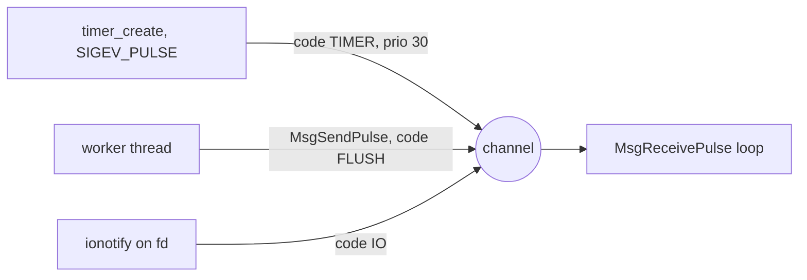
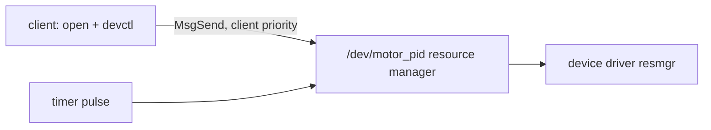
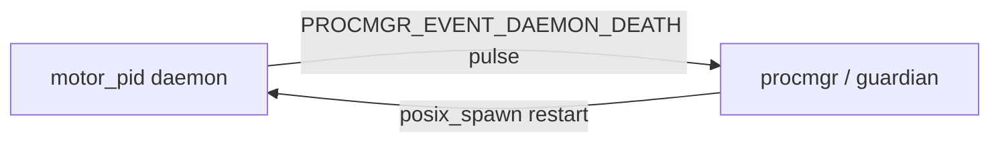

# QNX 8.0 Integration Report: samples/motor-pid-controller

Commit `local` · mode M1 · SDP 8.0.0 · generated 2026-11-10T22:17:53Z

**Readiness score: 0/100** (score = max(0, 100 - sum(weight(severity) x min(hits, 3))); blocker 15, high 6, medium 2, low 1; guarded findings weigh 0)

12 finding(s) across 5 file(s): 2 blocker, 1 high, 6 medium, 3 low, 0 info. 4 rule(s) depend on APIs missing from your QNX SDP 8.0.0 sysroot. Detected roles: device service, periodic control loop, daemon. Recommended shape on QNX: a /dev/motor_pid resource manager driven by a pulse timer. Readiness score 0/100 (deterministic formula).

## Compatibility audit

| Severity | Rule | Sysroot | Locations | Guidance |
| :--- | :--- | :--- | :--- | :--- |
| blocker | LNX-EPOLL epoll event loop | missing | `src/main.c:13`, `src/main.c:97`, `src/main.c:99`, `src/main.c:100` | epoll is a Linux-only readiness API. On QNX use POSIX poll()/select() for the lowest-effort port, or restructure the loop around a channel so I/O readiness (ionotify), timers and IPC all arrive as prioritized pulses on one receive call. |
| blocker | LNX-TIMERFD timerfd periodic timer | missing | `src/main.c:15`, `src/main.c:88`, `src/main.c:93` | Use a POSIX timer created with timer_create(CLOCK_MONOTONIC) whose sigevent is a pulse (SIGEV_PULSE_INIT) delivered to a channel. The receiving thread blocks in MsgReceivePulse() and wakes at the pulse priority you choose. For a simple loop, clock_nanosleep(TIMER_ABSTIME) avoids drift. |
| high | LNX-SYSFS Linux /sys paths | available | `src/motor_io.c:16` | There is no sysfs on QNX. PWM, GPIO and thermal data come from board-specific resource managers. Hide these behind a HAL and implement the QNX backend for your board's drivers. |
| medium | BLD-COMPILER Host-only compiler settings | available | `CMakeLists.txt:5`, `CMakeLists.txt:6` | Cross-compile with qcc/q++ and a -V variant (gcc_ntox86_64, gcc_ntoaarch64le). Remove host-only flags such as -march=native and hardcoded gcc, and do not fail the build when CMAKE_SYSTEM_NAME is not Linux. The kit's toolchain file sets all of this. |
| medium | LNX-AFFINITY sched_setaffinity | missing | `src/main.c:75`, `src/main.c:76` | On QNX pin threads with run-masks: ThreadCtl(_NTO_TCTL_RUNMASK_GET_AND_SET_INHERIT, ...) sets the calling thread's mask and the mask its children inherit. |
| medium | LNX-IOCTL ioctl on device descriptors | available | `src/motor_io.c:22` | QNX offers ioctl() as a wrapper over devctl() for common requests, but driver-specific requests must be rewritten against the QNX driver's DCMD_* set. Wrap device access in a small hardware-abstraction layer (HAL) so the Linux and QNX implementations can live side by side. |
| medium | LNX-LIBS Linux-only link libraries | missing | `CMakeLists.txt:9` | On QNX the pthread, real-time and dynamic-loading functions are part of libc. Drop a -l flag only if that library is missing from the sysroot (the audit checks this). In CMake prefer find_package(Threads) + Threads::Threads. |
| medium | LNX-PRIO-INV Mutex without priority inheritance in mixed-priority code | available | `src/main.c:67` | A mutex shared between threads of different priorities should use PTHREAD_PRIO_INHERIT so a low-priority holder is boosted while a high-priority thread waits. QNX message passing already applies client-priority inheritance by default, which is one reason to move shared state behind a resource manager. |
| medium | LNX-SYSTEMD systemd unit / watchdog script | available | `motor-pid.service:1` | QNX targets have no systemd. Start the service from the image's startup script (or SLM where available), daemonize with procmgr_daemon(), and supervise daemon processes using procmgr_event_notify_add(PROCMGR_EVENT_DAEMON_DEATH, ...) (or HAM where the optional High Availability package is installed). |
| low | LNX-CPU-BUDGET Background threads next to a real-time loop | available | `src/main.c:80` | Adaptive partitioning (APS) is not part of QNX SDP 8.0. To bound a background thread's CPU use, run it under SCHED_SPORADIC (budget + replenishment period), watch its per-thread CPU-time clock with a timer to detect overruns, pin it away from the control core with a run-mask, or use the QNX Hypervisor for hard isolation. |
| low | LNX-INOTIFY inotify file watching | available | `src/config_watch.c:4`, `src/config_watch.c:9`, `src/config_watch.c:11` | QNX 8.0 provides <sys/inotify.h>. Link with -lfsnotify and make sure the fsevmgr service runs on the target. This is a build-flag change, not a blocker. (link: -lfsnotify) |
| low | LNX-PERIODIC-SLEEP sleep-based periodic loop | available | `src/main.c:55`, `src/main.c:58` | A relative sleep inside a loop drifts by the loop body's run time. Use clock_nanosleep(CLOCK_MONOTONIC, TIMER_ABSTIME, ...) with a running deadline, or a pulse timer when the thread also needs to receive other events. |

## Pillar 1: Relevant QNX features

### channels pulses (relevance 5/5) ✓ sysroot

Component: `src/main.c`

`src/main.c` multiplexes timers, notifications and I/O in a Linux event loop. A QNX channel replaces it: each source sends a pulse with its own code and priority, and a single receive call hands them to the thread in priority order.

APIs: `ChannelCreate`, `ConnectAttach`, `MsgReceivePulse`, `MsgSendPulse`, `timer_create`, `SIGEV_PULSE_INIT`



### resource manager (relevance 5/5) ✓ sysroot

Component: `src/motor_io.c`

`src/motor_io.c` owns a device and a processing loop. On QNX that is naturally a resource manager: it registers /dev/motor_pid in the path space, clients use plain open/read/ write/devctl, and every request arrives as a message that inherits the client's priority. Device access moves out of client code into one process that can be restarted on its own.

APIs: `dispatch_create`, `iofunc_func_init`, `iofunc_attr_init`, `resmgr_attach`, `dispatch_context_alloc`, `dispatch_block`, `dispatch_handler`, `iofunc_devctl_default`



### sporadic scheduling (relevance 5/5) ✓ sysroot

Component: `src/main.c`

Background work in `src/main.c` can be given a CPU budget per replenishment period with SCHED_SPORADIC, so it cannot crowd out the time-critical loop. (Adaptive partitioning is not available in SDP 8.0; sporadic scheduling is the in-process tool.)

APIs: `pthread_attr_setschedpolicy`, `SCHED_SPORADIC`, `pthread_attr_setschedparam`

### ham (relevance 3/5) ✓ sysroot

Component: `motor-pid.service`

`motor-pid.service` relies on systemd or scripts for restarts. On QNX 8.0, procmgr_daemon() and procmgr_event_notify_add(PROCMGR_EVENT_DAEMON_DEATH) notify a guardian via kernel pulse immediately on process termination (or use HAM when the optional HA package is installed).

APIs: `procmgr_daemon`, `procmgr_event_notify_add`, `PROCMGR_EVENT_DAEMON_DEATH`, `posix_spawn`, `waitid`



### priority inheritance (relevance 3/5) ✓ sysroot

Component: `src/main.c`

`src/main.c` shares state between threads of different priorities. Priority inheritance on the mutex (or moving the shared state behind message passing, which inherits priority by default) prevents a low-priority holder from delaying the real-time thread.

APIs: `pthread_mutexattr_setprotocol`, `PTHREAD_PRIO_INHERIT`, `MsgSend`

### runmask affinity (relevance 3/5) ✓ sysroot

Component: `src/main.c`

`src/main.c` pins work to a CPU. QNX run-masks do this per thread and can set the mask that child threads inherit, keeping the control core free of background work.

APIs: `ThreadCtl`, `_NTO_TCTL_RUNMASK_GET_AND_SET_INHERIT`, `RMSK_SET`

### cpu time budget monitoring (relevance 2/5) ✓ sysroot

Component: `src/main.c`

Read each worker thread's CPU-time clock from `src/main.c` periodically (or arm a timer on it) to detect a thread that exceeds its expected budget and report or throttle it.

APIs: `pthread_getcpuclockid`, `clock_gettime`, `ClockId`, `timer_create`

### tracelogger (relevance 2/5) ✓ sysroot

Component: `src/main.c`

Capture a kernel event trace with tracelogger while motor_pid runs and inspect scheduling, IPC and interrupts in the System Profiler (Momentics or the VS Code QNX Toolkit) to confirm the timing behaviour after porting.

### hypervisor (relevance 1/5) ✓ sysroot

Component: `src/main.c`

When motor_pid must be isolated from untrusted or heavy workloads with stronger guarantees than in-OS scheduling, run them in separate guests under the QNX Hypervisor.

## Pillar 2: Concrete improvements

- **determinism latency** [static] The epoll loop treats every ready descriptor equally; a burst on one fd delays the periodic work handled by the same loop. → A channel-based loop receives pulses in priority order, so the control-timer pulse can be given a higher priority than configuration or telemetry events. (`src/main.c:13`, `src/main.c:97`, `src/main.c:99`)
- **determinism latency** [static] The control loop's timing relies on a Linux-specific timerfd read inside a general-purpose event loop. → A timer that delivers a pulse wakes the control thread directly at a chosen priority. Wake-up lateness can be measured on the target with the agent's timer benchmark. (`src/main.c:15`, `src/main.c:88`, `src/main.c:93`)
- **determinism latency** [static] CPU pinning uses a glibc-specific API. → Run-masks pin the control thread and its children to a reserved core. (`src/main.c:75`, `src/main.c:76`)
- **maintainability portability** [static] Device control calls are scattered through application code and tied to Linux request codes. → A HAL with a devctl()-based QNX backend isolates board-specific commands in one file. (`src/motor_io.c:22`)
- **determinism latency** [static] A high-priority control thread and a low-priority thread share a default mutex. If the low-priority holder is preempted, the control thread waits indefinitely (priority inversion). → With PTHREAD_PRIO_INHERIT the holder runs at the waiter's priority until it unlocks. The agent's timer benchmark under load shows the effect on wake-up lateness. (`src/main.c:67`)
- **fault isolation recovery** [static] Restart policy lives in systemd or a cron script, which QNX targets do not have. → procmgr_event_notify_add(PROCMGR_EVENT_DAEMON_DEATH) delivers a kernel pulse the instant a supervised daemon terminates so a lightweight guardian or HAM can respawn it. (`motor-pid.service:1`)
- **determinism latency** [static] Background threads have no CPU budget; a runaway worker can starve lower-priority work and delay the loop. → SCHED_SPORADIC caps a worker's high-priority execution per period, and a CPU-time clock lets the service detect overruns. (`src/main.c:80`)
- **determinism latency** [static] Relative sleeps accumulate drift equal to the loop body's execution time. → Absolute-deadline sleeps or pulse timers keep the period fixed. (`src/main.c:55`, `src/main.c:58`)
- **determinism latency** [qualitative] The periodic loop's wake-up lateness under background CPU load is unknown on QNX. → Run the agent's timer benchmark (1 kHz pulse timer, SCHED_FIFO) with and without low-priority load threads to measure wake-up lateness on your target.
- **fault isolation recovery** [qualitative] Device access and client handling live in one process with the application logic. → As a resource manager the service is a separate process that clients reach through open/read/devctl; it can be restarted without restarting its clients' code. The agent measures the time from spawn until /dev/<service> appears.
- **ipc efficiency** [qualitative] Clients exchange data with the service through Linux-specific mechanisms. → QNX synchronous message passing copies data directly between address spaces and inherits the client's priority. The agent's IPC benchmark measures MsgSend round trips.

## Pillar 3: Step-by-step guidance

### 1. Cross-compile with the QNX 8.0 toolchain

*toolchain_build · effort S · qcc snippet check: skipped*

Cross-compile with the kit's toolchain file (qcc/q++ with -V gcc_nto<arch>). Changes needed: Host-only compiler settings: Source qnxsdp-env.sh, then configure with the kit's toolchain file. Linux-only link libraries: Use Threads::Threads and drop -lrt/-ldl where the sysroot has no such library. inotify file watching: Add fsnotify to the QNX link libraries (the kit's qnx8.cmake snippet does this).

Before:

```c
set(CMAKE_C_COMPILER gcc)
add_compile_options(-O2 -Wall -march=native)
target_link_libraries(motor_pid pthread rt m)
```

After:

```c
# Add to motor-pid-controller's CMakeLists.txt after the target "motor_pid" is defined:
#   include(cmake/qnx8.cmake)

if(CMAKE_SYSTEM_NAME STREQUAL "QNX")
  target_compile_definitions(motor_pid PRIVATE _QNX_SOURCE)
  target_include_directories(motor_pid PRIVATE ${CMAKE_CURRENT_LIST_DIR}/../include)
  # From the sysroot audit: fsnotify (inotify file watching)
  target_link_libraries(motor_pid fsnotify)
  # These libraries do not exist in your QNX sysroot (their functions are in libc):
  #   pthread, rt  -> remove them from target_link_libraries for QNX builds.
endif()
```

Verify: `cmake -B build-qnx -DCMAKE_TOOLCHAIN_FILE=cmake/qnx8-toolchain.cmake -DQNX_ARCH=x86_64 && cmake --build build-qnx`

### 2. Replace the epoll loop

*api_migration · effort M · qcc snippet check: failed*

Start with poll() so the code builds and runs on QNX. Once it works, consider moving to a channel + pulse loop (see the resource-manager step) where each event source has its own pulse code and priority.

Before:

```c
/* src/main.c */
int ep = epoll_create1(0);
struct epoll_event ev = { .events = EPOLLIN };
ev.data.fd = tfd; epoll_ctl(ep, EPOLL_CTL_ADD, tfd, &ev);
if (cfd >= 0) { ev.data.fd = cfd; epoll_ctl(ep, EPOLL_CTL_ADD, cfd, &ev); }
```

After:

```c
#include <poll.h>

struct pollfd pfd[2] = {
    { .fd = tfd, .events = POLLIN },
    { .fd = cfd, .events = POLLIN },
};
int n = poll(pfd, 2, -1);
if (n > 0 && (pfd[0].revents & POLLIN)) {
    /* periodic work */
}
```

Verify: `qcc -Vgcc_ntox86_64 -fsyntax-only src/main.c`

### 3. Remove sysfs dependencies

*api_migration · effort M · qcc snippet check: skipped*

Wrap each sysfs access (PWM, thermal, GPIO) in a HAL function.

Before:

```c
/* src/motor_io.c */
if (!encoder_dev) encoder_dev = "/dev/ttyUSB0";
if (!pwm_path)    pwm_path    = "/sys/class/pwm/pwmchip0/pwm0/duty_cycle";

enc_fd = open(encoder_dev, O_RDWR | O_NOCTTY | O_NONBLOCK);
```

Verify: `grep -rn '"/sys/' src/  # should be empty outside hal_linux.c`

### 4. Wrap device control in a HAL

*api_migration · effort M · qcc snippet check: failed*

Move ioctl() calls behind functions such as hal_set_line(); implement the QNX side with devctl().

Before:

```c
/* src/motor_io.c */
int bits = TIOCM_DTR;
ioctl(enc_fd, TIOCMBIS, &bits);       /* wake the encoder bridge */

pwm_fd = open(pwm_path, O_WRONLY);
```

After:

```c
/* hal.h */
int hal_serial_set_dtr(int fd, int on);

/* hal_qnx.c */
#include <devctl.h>
#include <sys/dcmd_chr.h>
int hal_serial_set_dtr(int fd, int on)
{
    int bits = on ? (_SERCTL_DTR | _SERCTL_DTR_CHG) : _SERCTL_DTR_CHG;
    return devctl(fd, DCMD_CHR_SERCTL, &bits, sizeof bits, NULL);
}
```

Verify: `qcc -Vgcc_ntox86_64 -fsyntax-only src/hal_qnx.c`

### 5. Expose the service as a /dev/motor_pid resource manager

*resmgr_conversion · effort L · qcc snippet check: failed*

Start from the kit's resource-manager skeleton. Clients open /dev/motor_pid and use read(), write() and devctl() instead of a private socket or shared memory. The periodic work moves into the timer pulse handler, which runs serialized with client requests in one thread.

After:

```c
static int io_devctl(resmgr_context_t *ctp, io_devctl_t *msg, RESMGR_OCB_T *ocb)
{
    int status = iofunc_devctl_default(ctp, msg, ocb);
    if (status != _RESMGR_DEFAULT)
        return status;

    void  *data = _DEVCTL_DATA(msg->i);
    size_t nbytes = 0;

    switch (msg->i.dcmd) {
    case DCMD_MOTOR_PID_GET_STATUS:
        if (msg->i.nbytes < sizeof(state.status))
            return EINVAL;
        memcpy(data, &state.status, sizeof(state.status));
        nbytes = sizeof(state.status);
        break;
    case DCMD_MOTOR_PID_SET_VALUE: {
        int32_t v;
        if (msg->i.nbytes < sizeof v)
            return EINVAL;
        if (resmgr_msgread(ctp, &v, sizeof v, sizeof msg->i) != (ssize_t)sizeof v)
            return EFAULT;
        state.status.value = v;
        break;
    }
    default:
        return ENOSYS;
    }

    memset(&msg->o, 0, sizeof msg->o);
    msg->o.ret_val = EOK;
    msg->o.nbytes = (uint32_t)nbytes;
    return _RESMGR_PTR(ctp, &msg->o, sizeof msg->o + nbytes);
}
```

Verify: `ls -l /dev/motor_pid && motor_pidctl  # on the target`

### 6. Replace timerfd with a pulse-delivering POSIX timer

*scheduling_timing · effort M · qcc snippet check: failed*

The kit's qnx_compat.h provides qnx_periodic_timer_create()/qnx_periodic_timer_wait() built on timer_create() + SIGEV_PULSE_INIT + MsgReceivePulse(). Keep the control-loop body unchanged.

Before:

```c
/* src/main.c */
int tfd = timerfd_create(CLOCK_MONOTONIC, 0);
struct itimerspec its = {
    .it_interval = { 0, 1000000000L / LOOP_HZ },
    .it_value    = { 0, 1000000000L / LOOP_HZ },
};
timerfd_settime(tfd, 0, &its, NULL);

int cfd = config_watch_start(cfg);
```

After:

```c
#include "qnx_compat.h"

qnx_periodic_timer_t t;
if (qnx_periodic_timer_create(&t, 1000000 /* ns */, 30 /* pulse prio */) != 0)
    return 1;
for (;;) {
    if (qnx_periodic_timer_wait(&t) != 0)
        break;
    /* control-loop body */
}
```

Verify: `qcc -Vgcc_ntox86_64 -fsyntax-only -Iinclude src/main.c`

### 7. Pin the control thread with a run-mask

*scheduling_timing · effort S · qcc snippet check: failed*

Replace sched_setaffinity() with ThreadCtl() and a run-mask.

Before:

```c
/* src/main.c */
CPU_ZERO(&set);
CPU_SET(1, &set);
if (sched_setaffinity(0, sizeof set, &set) != 0)
    perror("sched_setaffinity");
```

After:

```c
#include <sys/neutrino.h>

unsigned mask[2] = { 1u << 1, 1u << 1 };   /* run mask, inherit mask: CPU 1 */
if (ThreadCtl(_NTO_TCTL_RUNMASK_GET_AND_SET_INHERIT, mask) == -1)
    perror("ThreadCtl runmask");
```

Verify: `pidin -p <service> -F '%a %b %N %i'  # on target`

### 8. Enable priority inheritance on shared mutexes

*scheduling_timing · effort S · qcc snippet check: failed*

Initialize the mutex with a PTHREAD_PRIO_INHERIT attribute.

Before:

```c
/* src/main.c */
pthread_mutex_init(&gains_lock, NULL);
load_gains(cfg);
```

After:

```c
pthread_mutexattr_t ma;
pthread_mutexattr_init(&ma);
pthread_mutexattr_setprotocol(&ma, PTHREAD_PRIO_INHERIT);
pthread_mutex_init(&gains_lock, &ma);
pthread_mutexattr_destroy(&ma);
```

Verify: `advisorctl bench-timer --load 4  # compare lateness before/after`

### 9. Bound background threads with SCHED_SPORADIC

*scheduling_timing · effort M · qcc snippet check: failed*

Give the telemetry/worker thread a sporadic budget and low replenishment priority.

Before:

```c
/* src/main.c */
struct sched_param sp = { .sched_priority = 80 };
pthread_setschedparam(pthread_self(), SCHED_FIFO, &sp);

if (motor_io_open(NULL, NULL) != 0)
```

After:

```c
struct sched_param p = {0};
p.sched_priority = 20;                               /* normal priority */
p.sched_ss_low_priority = 8;                         /* after budget runs out */
p.sched_ss_max_repl = 4;
p.sched_ss_repl_period.tv_nsec = 100 * 1000 * 1000;  /* 100 ms */
p.sched_ss_init_budget.tv_nsec = 10 * 1000 * 1000;   /* 10 ms per period */
pthread_attr_setinheritsched(&attr, PTHREAD_EXPLICIT_SCHED);
pthread_attr_setschedpolicy(&attr, SCHED_SPORADIC);
pthread_attr_setschedparam(&attr, &p);
```

Verify: `pidin -p <service> -F '%a %b %p %i'  # policy column shows sporadic`

### 10. Use absolute-deadline sleeps for periodic work

*scheduling_timing · effort S · qcc snippet check: failed*

Replace relative sleeps in periodic loops with clock_nanosleep(TIMER_ABSTIME).

Before:

```c
/* src/main.c */
    double sp = setpoint_rpm;
    usleep(2000);                        /* slow formatting while holding the lock */
    pthread_mutex_unlock(&gains_lock);
    printf("sp=%.0f rpm=%.1f duty=%.1f%%\n", sp, last_rpm, last_duty);
    usleep(100000);
}
return NULL;
```

After:

```c
struct timespec next;
clock_gettime(CLOCK_MONOTONIC, &next);
for (;;) {
    do_work();
    next.tv_nsec += PERIOD_NS;
    while (next.tv_nsec >= 1000000000L) { next.tv_nsec -= 1000000000L; next.tv_sec++; }
    clock_nanosleep(CLOCK_MONOTONIC, TIMER_ABSTIME, &next, NULL);
}
```

Verify: `qcc -Vgcc_ntox86_64 -fsyntax-only src/main.c`

### 11. Replace systemd supervision with startup script + procmgr death notifications

*reliability_security · effort M · qcc snippet check: failed*

Daemonize with procmgr_daemon() and register PROCMGR_EVENT_DAEMON_DEATH pulse notifications (or attach to HAM if installed).

Before:

```c
[Unit]
Description=Motor PID controller (1 kHz)
After=network.target

[Service]
Type=simple
ExecStart=/usr/local/bin/motor_pid /etc/motor-pid/gains.conf
Restart=always
RestartSec=1
CPUSchedulingPolicy=fifo
CPUSchedulingPriority=80
WatchdogSec=2
```

After:

```c
#include <sys/procmgr.h>
#include <sys/siginfo.h>

struct sigevent ev;
SIGEV_PULSE_INIT(&ev, main_coid, 20, PULSE_CODE_SHUTDOWN, 0);
int handle = procmgr_event_notify_add(PROCMGR_EVENT_DAEMON_DEATH, &ev);
(void)handle;
```

Verify: `pidin -F '%a %b %N'  # on target, confirm supervised daemon running`

### 12. Build, deploy and verify on a QNX 8.0 target

*deploy_verify · effort M · qcc snippet check: skipped*

Build the kit binaries with qcc, boot the QEMU target with mkqnximage, copy the binaries over SSH and run them under the advisor agent, which checks that the resource manager comes up and measures timer and IPC behaviour.

Verify: `advisorctl verify /data/home/qnxuser/motor_pid_resmgr --expect /dev/motor_pid --timeout 5000`


Unverified claims removed by the guard: 0
